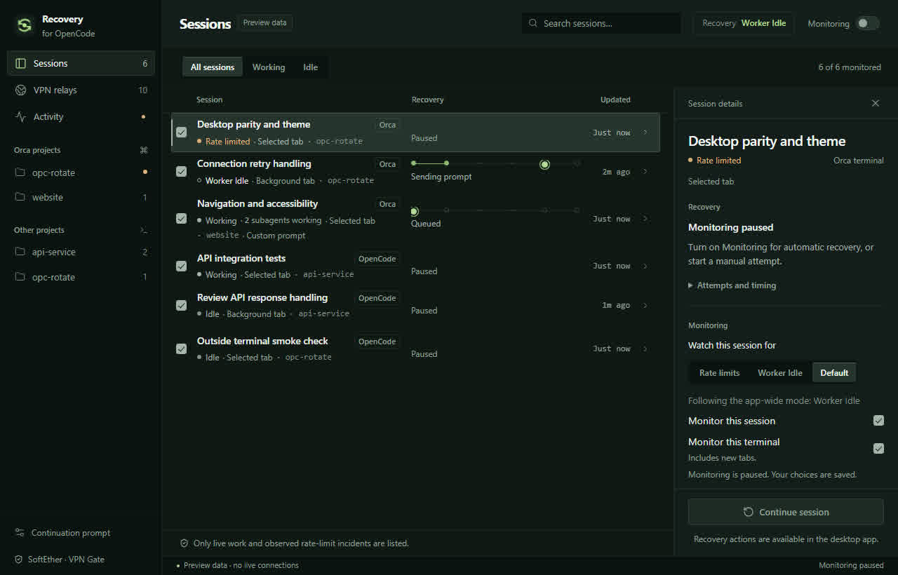

# OpenCode Recovery

A Windows desktop dashboard for live OpenCode work. Choose which sessions to monitor, inspect their status by project, and recover affected work through the installed SoftEther VPN Client.

[](https://github.com/edisonmalasan/opc-rotate/actions/workflows/windows.yml) · [MIT license](LICENSE) · [Changelog](CHANGELOG.md)



*Development preview with sample data. No live connection is shown.*

## Status and downloads

**0.1.0 preview candidate — Windows x64.** The repo builds an NSIS installer. Live recovery using the new exact-session transport and clean-PC installation still need verification; see [known limitations](docs/USAGE.md#preview-limitations).

Installers will be listed under [GitHub Releases](https://github.com/edisonmalasan/opc-rotate/releases) when published. For a tested commit before publication, download the installer and matching `SHA256SUMS.txt` from its successful [Windows workflow run](https://github.com/edisonmalasan/opc-rotate/actions/workflows/windows.yml), or [build from source](docs/DEVELOPMENT.md). Current packages are unsigned and have no automatic updater.

## What it does

- Shows live tabs from Orca and other terminals as flat rows, including idle and background sessions.
- Saves monitoring choices per session or terminal, with editable continuation prompts.
- Watches either for provider rate-limit failures, recovered by changing the public IP, or for a session whose turn has finished, recovered with a prompt and no network change.
- Shows each session's recovery stage, retry eligibility, verified IP-change count, and last confirmed prompt time.
- Ranks VPN Gate relays by ping and advertised speed, then controls the separately installed SoftEther client.
- Waits for detected work to become idle, verifies a changed public IPv4 address, and addresses continuation to the exact affected session.
- Bounds relay attempts and IP changes, records activity, and avoids automatically repeating uncertain prompt submissions.

## Get started

1. Install **SoftEther VPN Client** in its default location, with its service running and an enabled virtual adapter named **VPN**. The VPN Gate Client plug-in is optional; Recovery fetches its own relay list.
2. Use **OpenCode v2 with CLI tab-plugin support** (verified with 2.0.32). For Orca terminals, also make the `orca` CLI available on `PATH`.
3. Install and open Recovery. Keep your existing terminals open. If a session is missing, reopen that OpenCode client once to load Recovery's presence plugin.
4. Select the sessions or terminals you want included, then enable **Monitoring**. It starts off on a fresh install.
5. Choose what the app watches for. The **Recovery** control in the top bar sets the mode for every session; a session can override it in its inspector.

**Rate limits** recognizes rate-limit/quota failures and the specific failed-provider message “OpenCode's free tier can only be used from within OpenCode.” Recovery changes the public IP through a relay, waits for the new address to take effect, verifies it, and only then sends the continuation. A VPN change affects the whole machine, so all detected busy sessions delay it, including excluded sessions. A new IP does not guarantee the provider will accept the request.

**Worker Idle** watches for a session whose turn finished cleanly and sends it a continuation prompt. It never touches the network, and the VPN parts of the interface are hidden while it is the mode in use. A session that still has subagents working is never treated as idle.

The two modes use different default continuations, and you can edit either of them globally or per session. Recovery preserves your terminals and the selected OpenCode tab.

See [setup, usage, and troubleshooting](docs/USAGE.md) for requirements, delivery safeguards, local data, and uninstall steps.

## Build and verify

On Windows x64 with the [development prerequisites](docs/DEVELOPMENT.md):

```powershell
npm ci
npm run tauri -- dev
```

For a checked installer and checksum:

```powershell
npm run check:release
npm test
npm run release:build
```

Files appear in `release-artifacts/v0.1.0/`. Automated tests use mocked VPN responses and do not change your connection. The desktop dev command chooses a free port from 1420–1499. Browser-only UI checks use `npm run dev` with `?preview=1`; preview fixtures are excluded from release builds.

## Documentation

- [Setup and use](docs/USAGE.md)
- [Development](docs/DEVELOPMENT.md) and [contributing](CONTRIBUTING.md)
- [Release process and acceptance checklist](docs/RELEASING.md)
- [Source map and current status](docs/CONTEXT.md)
- [Roadmap](docs/ROADMAP.md) and [changelog](CHANGELOG.md)
- [Security reports](SECURITY.md)

## License

[MIT](LICENSE), copyright 2026 Edison Malasan. Bundled third-party skills and dependencies retain their own license notices. OpenCode, Orca, SoftEther, and VPN Gate are separate projects; this app does not bundle their clients.
